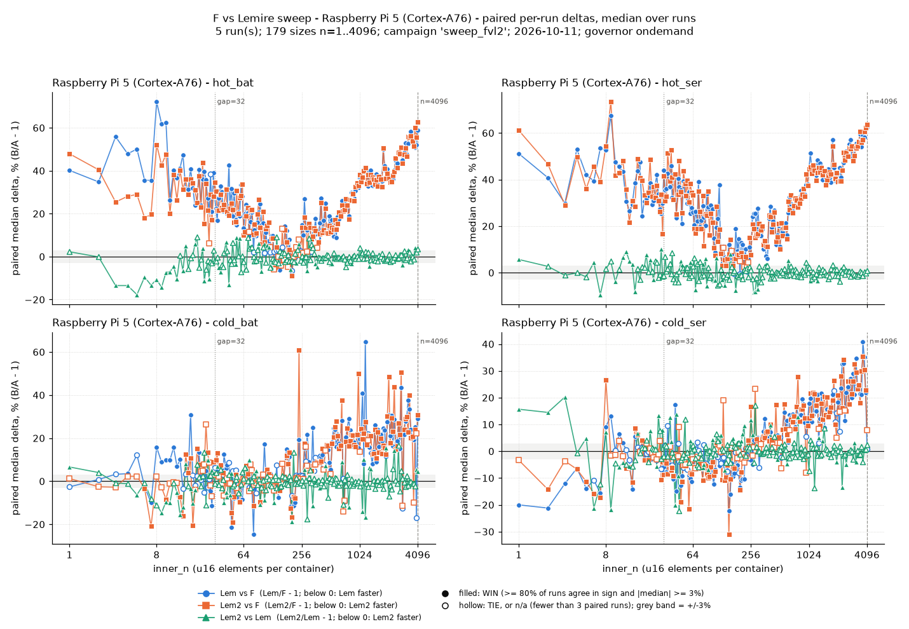
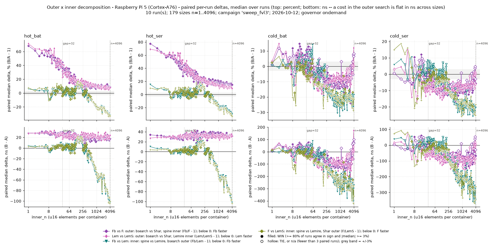
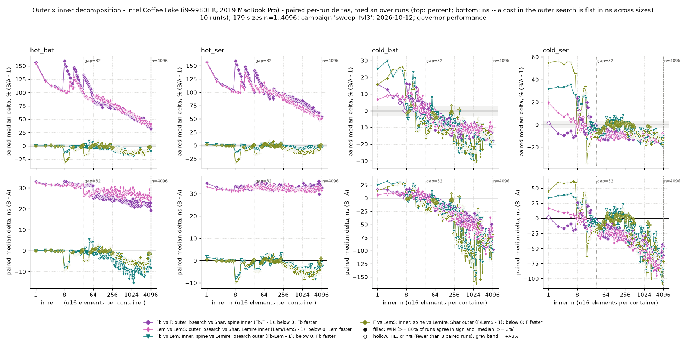
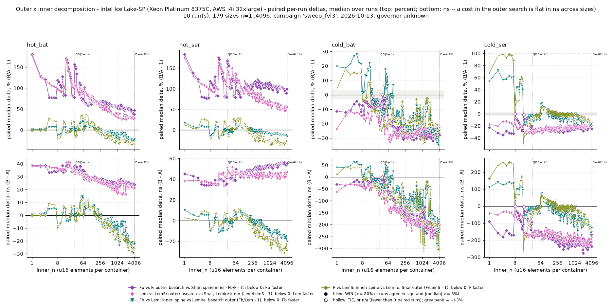

# shar-spine-quad

Machine-optimized variants of Daniel Lemire's "SIMD Quad" search for small
sorted `uint16_t` arrays (n = 1..4096, the shape inside Roaring Bitmap array
containers), plus a two-level benchmark that combines an outer container
search with the tuned inner search for a full 512-container × 4096-element
lookup. Six hosts, four kernel files, one arch-aware benchmark driver.

> **Results corrected 2026-10-11.** A full review found that the kernels are
> correct and the large effects are real, but that several published
> comparisons rested on a mis-aimed prefetch in the Eytzinger variants, on
> medians differenced across drifting runs, on a retired benchmark harness,
> and on plot data without an archived source. Everything below was
> rewritten from paired per-run analysis of the archived runs plus a fresh
> ten-run campaign on the Raspberry Pi 5. The full list of retracted claims
> and their replacements is `Text/corrections_2026-10.md`; when any other
> document disagrees with it, that file wins.

## Hosts and variants

| Host | Core | Cache line | SIMD used | Gap | Block check | In-loop prefetch |
|---|---|---|---|---|---|---|
| Raspberry Pi 5 | Cortex-A76 | 64 B | 128b NEON | 32 | 2× `vld1q_u16_x2` + 4 cmp | no (removed 2026-10-13 after the dedicated A/Bs; the Pi 5 and Graviton kernels are now the same code) |
| Apple M1 Pro | Firestorm | 128 B | 128b NEON | 64 | 2× `vld1q_u16_x4` + 8 cmp | no |
| Apple M4 Max | M4 P-core | 128 B | 128b NEON | 64 | same file as M1 Pro | no |
| Intel Skylake-SP (8175M) | Skylake | 64 B | AVX2 (zmm gated off) | 32 | 2× ymm cmpeq + movemask | no (removed 2026-10-13 with Coffee Lake's: same core, same AVX2 path) |
| Intel Emerald Rapids (8559C) | Raptor Cove | 64 B | AVX-512 + VBMI2 | 32 | 1× zmm cmpeq + kortest | no |
| AWS Graviton 4 | Neoverse V2 | 64 B | 128b NEON | 32 | same code as the Pi 5 spine kernels | no |
| Intel Coffee Lake (i9-9980HK, 2019 MacBook Pro under Ubuntu; added 2026-10-12) | Skylake-class client core | 64 B | AVX2 (no AVX-512) | 32 | same AVX2 path as Skylake-SP | no (removed 2026-10-13: slower warm at every main-bench size from 333 up and slower or tied cold, `cfl_runs/prefetch_ab_findings.md`) |
| Intel Ice Lake-SP (2× Xeon Platinum 8375C, AWS i4i.32xlarge; added 2026-10-13) | Sunny Cove | 64 B | AVX-512 + VBMI2 | 32 | 1× zmm cmpeq + kortest (as Emerald Rapids) | no (the zmm path never had one) |

The kernels: `simd_quad.c` (Lemire's reference), `simd_quad_pi5.c`,
`simd_quad_m4.c` (M1 Pro and M4 Max), `simd_quad_intel.c` (Skylake, Coffee
Lake and Emerald Rapids), `simd_quad_graviton.c`. Each tuned file has a general-n
"spine" kernel (a contiguous array of block-last keys that turns the
quaternary descent into a short streaming read) and compile-time
specializations for n ∈ {256, 512, 1024, 2048, 4096} where measured.

## What the measurements support

* **The spine is the biggest single win on every host**: roughly 2× on the
  Pi 5 (a true DRAM miss) and 2.6× on the M4 Max (3.3× on the M1 Pro, where
  the pre-flush main bench's cold column was an L2/SLC hit) at n = 4096. The
  mechanism is a short contiguous read with memory-level parallelism, not a
  hardware stride prefetcher.
* **Compile-time specialization at n = 4096 ("hybrid": straight-line descent
  + branchless 2-probe finish) is a robust warm win.** Versus the retired
  unroll: −55% Emerald Rapids and −29% Skylake (ratios of 5-run medians),
  −31% Pi 5 (paired per-run median), −4% M1 Pro, a tie on M4 Max. Versus the
  general-n spine on Skylake it is −32% warm (5/5) but +40% cold (paired
  median, hybrid faster in only 2 of 5 runs) against a control stable to
  ±0.6%, a cost that is not yet explained.
* **At n = 4096 containers the tuned two-level stack beats Lemire's published
  variant on every host and every mode** (paired per-run deltas, 5 archived
  runs per host; F = Shar outer + compile-time inner, Lem = bsearch outer +
  gap-16 SIMD Quad):

  | host | hot_bat | hot_ser | cold_bat | cold_ser |
  |---|---|---|---|---|
  | Pi 5 | −35% (5/5) | −39% (4/5) | −28% (5/5) | −17% (5/5) |
  | M4 Max | −84% (5/5) | −80% (5/5) | −37% (5/5) | −43% (5/5) |
  | M1 Pro | −68% (5/5) | −61% (5/5) | −28% (5/5) | −21% (5/5) |
  | Skylake-SP | −69% (5/5) | −70% (5/5) | −29% (4/5) | −14% (5/5) |
  | Emerald Rapids | −69% (5/5) | −61% (5/5) | −45% (5/5) | −26% (5/5) |
  | Graviton 4 | −65% (5/5) | −74% (5/5) | −25% (5/5) | −7% (4/5) |

  Ten runs of the repaired harness on the Pi 5 (2026-10-11) give F vs Lem
  −37.5% / −39.4% hot (10/10), −17% cold_bat (7/10, a tie) and −30.5%
  cold_ser (8/10).
* **Which outer search wins depends on the host and the cache state.** Best
  variant per mode by paired per-run rank (A = bsearch + general-n inner,
  B = outer spine + general-n, C = bsearch + compile-time inner, D = outer
  spine + compile-time inner, E = Shar + general-n, F = Shar + compile-time,
  H/I = Eytzinger + prefetch, measured before the prefetch fix except on the
  Pi 5):

  | host | hot_bat | hot_ser | cold_bat | cold_ser |
  |---|---|---|---|---|
  | Pi 5 (repaired harness, 10 runs) | **D** (B, E, F within 3%) | **D** | **D** (F +45%) | noise |
  | M4 Max | F (I ties) | F | E (F ties) | B |
  | M1 Pro | I (F ties) | I (−11% vs F, 4/5) | F | A |
  | Skylake-SP | F | F | C (D beats F 4/5) | D |
  | Emerald Rapids | I (−0.7% vs F, negligible) | F | C | C |
  | Graviton 4 | I (−11% vs F, 5/5) | F | C | C |

  Shar's branchless outer (E, F) wins hot on the five fast hosts because it
  has no branch mispredicts and no side structure; it is a *serial*
  load-compare-select chain, not a set of independent loads. Cold, the
  branchy `std::lower_bound` (C) or the outer spine (D) usually wins because
  the core can speculate ahead across a branchy search but not past a cmov
  chain. On the Pi 5 the outer spine (D) is best or tied-best in three modes.
* **Lemire's kernel is still faster for small containers on the M4 Max, and for cold serial lookups below n ≈ 265 on the Pi 5.** The M4 Max sweep
  across container sizes (200 sizes, 5 runs) has Lemire ahead, by paired
  per-run analysis (`m4_runs/sweep_fvl_paired.txt`), in the bands n = 48–62
  and 81–128 (hot_bat, medians 5–32%) and n ≤ 7 and 60–156 (cold_ser,
  6–47%), with narrower wins at a few other sizes below 256: the gap-64
  kernel's small-n paths end in long scalar sweeps and the spine is inert below n = 256 on 128-byte-line hosts.
  The Pi 5 sweep (`pi5_runs/sweep_fvl2_raw.txt`, 179 sizes, 10 runs over two sessions, against both the 2026-04-27 kernel and Lemire's revised 2026-10-02 kernel; `pi5_runs/sweep_fvl2_findings.md`) has no such hot bands: F is faster hot at essentially every size (+8% to +64%) and Lemire wins no hot cell, while in cold_ser Lemire is ahead below n ≈ 265 (a paired WIN at 49 of 96 sizes against 1 for F, mostly by 3–14%) and F above n ≈ 320 (65 of 78, by 3–54%). The revised kernel changes no verdict. Five runs resolve long bands, not single sizes: on identical code (the two Lemire kernels from n = 16 up) the 5-run WIN rule fires at 16–23% of sizes, the 10-run rule at 3–9%.
  The cold_ser deficit is the outer search, not the kernel: a second Pi 5 campaign on the same arrays and targets (`sweep_fvl3`, 2026-10-12, 10 runs, `pi5_runs/sweep_fvl3_findings.md`) added the two cross variants — bsearch outer + our spine inner, and Shar outer + Lemire's inner — and both pairs that differ only in the outer show the branchy `std::lower_bound` costing a flat 18–33 ns per query hot at every size and saving a flat 45–110 ns per query cold from n ≈ 33 up, with either inner (figure below). Between n = 33 and 265 the inner kernel is neutral or favours the spine, so Lemire's cold_ser lead there is entirely the outer; above n ≈ 300 the spine's cold gain (−118 to −274 ns against Lemire's inner) outgrows that flat penalty. Below n = 8 the deficit is the kernel's scalar path (measured the same night: a constant-return rewrite gains 5–13% cold_ser at most sizes below 32 but loses 9–14% cold_bat at n = 5–7, so it was not adopted). The two campaigns' F-vs-Lemire verdicts agree on 592 of 716 cells and never call opposite winners.
* **The Pi 5 kernel leads were measured; only the prefetch came out.** A kernel A/B campaign on the second Pi 5 board (`sweep_ab1`, 2026-10-12, 7,160 cells, drift 1.00–1.01×; `pi5_runs/sweep_ab1_findings.md`) timed six variants of the two-level lookup that differ only in the inner kernel: rewriting the small-n scalar sweeps with constant returns gains 5–13% in cold_ser at most sizes below 32 but loses 9–14% in cold_bat at n = 5–7, so it was not adopted; the spine's delegation threshold stays at three blocks, because descending the spine from two blocks is 8–26% slower hot at 64–124 and delegating four to seven blocks to the plain kernel saves 8–12 ns hot for 82–98 ns cold_bat; the in-loop prefetch turned out to be a regime trade in this harness (3–14% faster hot from n ≈ 667, 3–8% slower cold) and a loss in both regimes of the flushed main bench (ten paired runs on the same board: slower warm at every size from 128 up, slower cold at 12 of 14), so it was removed; and line-aligned arrays and spines are 3–7% faster cold from n ≈ 512 in the two-level harness and 14–38% faster cold from n = 128 up in the main bench for the Pi 5 spine kernel (WIN at 13 of the 14 sizes, all 10/10, a tie at n = 1234; the byte-identical Graviton column 21–36% with the same tie, the Apple-kernel column 8–33% with 10/10 at every size; an upper bound, because the aligned copies' regular layout also streams better in that harness's sequential cold sweep), at no warm cost in the main bench; the 4–17 ns hot cost that the kernel A/B harness showed for its aligned copies turned out to be that harness's own carry-over asymmetry, not alignment — the layout experiment of 2026-10-13 (`pi5_runs/layout1_findings.md`: one kernel on seven storage layouts of the same arrays, 26 sizes × 4 modes × 10 runs, repeated with the pre-removal kernel) has alignment 5–17 ns (3–25%) faster hot at 32–1024 and 2–3 ns (about 1%) at 4096, 48–74 ns faster cold at 3072–4096 and nothing cold below 512, a layout-preserving copy 18–72 ns slower cold than the originals by band (fresh pages), and a spine allocated away from its array 40–65 ns slower cold at n ≥ 1024; tiny containers pay footprint when padded to a line, aligned-and-packed ones do not.
* **The same decomposition holds on an Intel client core.** The Coffee Lake host (i9-9980HK, a 2019 MacBook Pro under Ubuntu, onboarded 2026-10-12 and driven over ssh; `cfl_runs/cfl_findings.md`) ran the five-variant sweep at 179 sizes and 10 runs (`cfl_runs/sweep_fvl3_raw.txt`): F beats both Lemire kernels hot at every size by a flat 28–38 ns that is entirely the outer search (the branchy `std::lower_bound` costs +23–32 ns hot_bat and +32 ns hot_ser with either inner), Lemire is ahead in cold_ser below n ≈ 512 because that same outer saves 19–36 ns cold there (growing with n on this core — 19 ns at n = 33–128, 36 ns at 266–512, 68 ns at 2049–4096 — where the Pi 5 saved a flat 45–110 ns) while the spine inner is neutral cold_ser up to 265 and ahead from 266, and there is no four-to-seven-block hot deficit on this core (the spine inner's hot losses are a few small outer-dependent bands below n = 256, 3–10%: 48–62 with the bsearch outer, one block plus a long scalar tail, and 64–66, 81–95, 120–124 and 210–217 with the Shar outer, 81–95 also costing 3–4% in hot_ser with the bsearch outer). Its flushed main bench (10 runs) also measured the alignment question: line-aligned arrays and spines make the spine kernel 26–40% faster cold at every size from n = 617 up (26–35% from 512 up with turbo off) and change nothing warm. The laptop throttles under turbo (two of ten two-level runs 4× slower hot), so the sets were repeated with turbo disabled; the stable two-level set has F best in hot_ser (10/10), C best in cold_bat (10/10, F 7% behind), D best in cold_ser, F vs Lemire −50% / −62% / −38% / −6% (10/10 in every mode), and the Eytzinger outer 10–17% behind F in three modes — the Skylake-SP / Emerald Rapids pattern. The sweep repeated at the 2.4 GHz base clock reproduces every hot verdict of the four outer-contrast pairs (Lem vs F, Lem2 vs F, Fb vs F, Lem vs LemS) size for size, moves the other verdicts only between WIN and TIE (2–27 hot sizes for the gauge and the two inner pairs, 14–53 cold sizes per pair and mode) and calls an opposite winner in one of the 5,012 compared cells (Lem2 vs F, cold_bat, n = 161: −3.7% with turbo, +3.6% without, 8/10 each; `cfl_runs/sweep_fvl3_turbo_vs_noturbo.txt`); the outer's hot cost doubles in nanoseconds when the clock halves, so it is a fixed count of cycles, while its cold saving from n ≈ 266 up changes by only 1–25%. Two kernel A/Bs on the same laptop (`cfl_runs/prefetch_ab_findings.md`) then removed the Intel kernel's remaining in-loop prefetch — ten interleaved flushed main-bench pairs have the kernel without it 3.6–7.5% faster warm at every size from 333 up (10 of 10 pairs in every cell) and faster or tied cold, and the two-level kernel A/B (7,160 cells) has it a tie hot (faster without it only at 3710–4096) and a 10–31 ns cold_bat / 6–15 ns cold_ser loss — and found that the spine inner's small hot-loss bands are the scalar sweep of the partial last block: a 32-element vector membership test in its place is 3–14% faster at 42–62 and 3–8.5% at 81–95 with no loss in any band (four isolated cold cells of +3.7% to +4.3%, two of them at sizes where the tail code never runs), and leaves Lemire's kernel ahead at one hot_bat size of 179 instead of nine (two instead of twelve in hot_ser). The Ice Lake-SP kernel A/B confirmed the tail on the zmm path (wins at 27–39 sizes per hot mode, no effect loss), and it was adopted into `simd_quad_intel.c` on 2026-10-17, checked exhaustively on both paths.
* **An Ice Lake-SP server reverses the cold verdict in favour of the branchy outer.** The user's AWS i4i.32xlarge (two Xeon Platinum 8375C, Sunny Cove, zmm path; onboarded 2026-10-13, `icx_runs/icx_findings.md`) ran the same three campaigns: F beats Lemire hot at all 179 sizes (+23 to +70 ns, all of it the outer) and in hot_ser of the two-level harness by 75% (10/10), but cold the bsearch outer is ahead of Shar's cmov chain at almost every size (Fb vs F WIN at 174 and 177 of 179 sizes; by band 93–222 ns per query in cold_ser, and in cold_bat 21 ns at n = 1–32, 64 at 33–128 and 126–221 from 129 up; nine dependent misses that the out-of-order core cannot overlap, against speculated ones), so Lemire's stack leads cold_ser at 170 of 179 sizes and C (bsearch outer + compile-time inner) beats F by 23% cold_bat and 30% cold_ser in the two-level harness (10/10). The spine inner itself is ahead in cold_bat behind either outer from n ≈ 33 up (−30 to −192 ns behind bsearch, −67 to −201 behind Shar, by band) and in cold_ser from 129 up behind bsearch (−17 to −109 ns) but only from 266 up behind Shar (−18 to −98 ns); the compile-time family wins 34–38% warm and 25–37% cold, line alignment makes the spine kernel 14–29% faster cold from n = 512 up, and the Eytzinger outer never beats Shar hot or the branchy outer cold. Ship reading there: F for hot lookups, two-level A or C for cold ones. Its kernel A/B (`icx_runs/icx_findings.md`) confirmed the vector tail on the zmm path — the same bands as on Coffee Lake, no effect loss, Lemire's hot wins against the spine inner halved from 25 sizes to 12 — and showed that in the two-level harness the variant timed first in each run's hot_bat pass ran 1.9–2.7 times slower on this instance, so its hot_bat ranks are read from sign counts.
* **The Eytzinger + prefetch outer (Khuong & Morin 2017) does not pay off on
  the Pi 5** once the prefetch is aimed correctly: I is 7–9% slower than F
  hot and never beats D. Its M1 Pro hot_ser edge (−11%, 4/5) and Graviton 4
  hot_bat edge (−11%, 5/5) were measured with the mis-aimed prefetch and
  need re-measurement.

### Single-lookup latency at n = 4096 (ns per query, medians of 5 runs)

| host | general-n spine kernel, warm / cold | compile-time n=4096 hybrid, warm / cold |
|---|---|---|
| M4 Max | 4.3 / 6.5 | 3.7 / 21.9 |
| M1 Pro | 6.3 / 11.1 | 6.1 / 32.1 |
| Emerald Rapids | 18.0 / 37.2 | 6.5 / 24.4 |
| Graviton 4 | 16.2 / 34.6 | 7.0 / 27.2 |
| Pi 5 | 22.5 / 150.7 | 16.0 / 111.9 |
| Skylake-SP | 26.8 / 132.7 | 18.9 / 185.0 |

Sources: `{host}_runs/rebench_run*.txt` for the spine column; the hybrid
column from `{host}_runs/hybrid_run*.txt` (M4 Max, M1 Pro, Skylake),
`emr_runs/shipped_run*.txt`, `gv4_runs/fullsweep_run*.txt` and the Pi 5
rebench rows, as recorded in `plot.py`. Two caveats: these main-bench cold
numbers were measured before `bench.cpp` got its cache flush (added
2026-10-11), so in them "cold" is a DRAM miss on the Pi 5 but an L2/L3 hit
on the other hosts (compare within a host, not across hosts; a flushed
re-run on every host is pending — done for the Pi 5 (one run on the first
board, `pi5_runs/rebench_flushed_run1.txt`, and ten on the second,
`pi5_runs/rebench_flushed_eight_run*.txt`, 2026-10-12/13: small-n cold cells
at 35–60 ns against 5–20 ns in the archive, paired analysis in
`pi5_runs/rebench_flushed_findings.md`) for Coffee Lake (`cfl_runs/`) and for Ice Lake-SP (`icx_runs/`),
not yet for the other hosts); and the Apple hybrid cold numbers may be
a measurement-order artifact rather than a kernel property (see the
corrections document, section 5).












Curves show 22 sizes for the Pi 5 and the 10 power-of-two sizes for the
other hosts; only values with an archived raw run are plotted.

## Quick start

```sh
./reproduce.sh            # detects host, builds, runs bench + bench_twolevel, compares to archived medians
./reproduce.sh --runs 5   # per-cell median of 5 runs
./reproduce.sh --quick    # lighter 2000×2000 intensity (every cold pass still runs the 512 MB flush)

# Two-level campaign with randomised variant order, then paired analysis
./run_twolevel.sh pi5 10
python3 compute_twolevel_paired.py pi5 --glob 'pi5_runs/twolevel_v2_run*.txt' --out pi5_runs/twolevel_paired_v2.txt
```

The paired aggregator reports per-run sign counts and paired medians. Quote
those, never the difference of two per-variant medians: whole runs drift
1.5× on the Pi 5 and up to 1.5× on the M4 Max, and ratios of medians taken
from different runs produced several of the retracted claims.

## Manual build

```sh
# Raspberry Pi 5
g++ -O3 -mcpu=cortex-a76 -std=c++20 bench.cpp simd_quad_pi5.c simd_quad_m4.c simd_quad_graviton.c -o bench
g++ -O3 -mcpu=cortex-a76 -std=c++20 -DQUADSEARCH_ARM_PI5 bench_twolevel.cpp simd_quad_pi5.c -o bench_twolevel

# Apple M4 Max / M1 Pro (-mcpu=apple-m1 for the M1)
clang++ -O3 -mcpu=apple-m4 -std=c++20 bench.cpp simd_quad_pi5.c simd_quad_m4.c simd_quad_graviton.c -o bench
clang++ -O3 -mcpu=apple-m4 -std=c++20 bench_twolevel.cpp simd_quad_m4.c -o bench_twolevel

# AWS Graviton 4
g++ -O3 -mcpu=neoverse-v2 -std=c++20 bench.cpp simd_quad_pi5.c simd_quad_m4.c simd_quad_graviton.c -o bench
g++ -O3 -mcpu=neoverse-v2 -std=c++20 -DQUADSEARCH_ARM_GV4 bench_twolevel.cpp simd_quad_graviton.c -o bench_twolevel

# Intel with AVX-512 + VBMI2 (Ice Lake-SP, Sapphire / Emerald / Granite Rapids).
# Note: -march=x86-64-v4 does NOT define __AVX512VBMI2__ and silently builds the AVX2 path.
g++ -O3 -march=sapphirerapids -std=c++20 bench.cpp simd_quad_intel.c -o bench

# Intel Skylake-SP (AVX-512BW but no VBMI2; the zmm block check is gated off on purpose)
g++ -O3 -march=native -std=c++20 bench.cpp simd_quad_intel.c -o bench
```

`./bench 4000 5000` is the canonical intensity; it prints `correctness: ok`
before the table. `./bench_twolevel [sets] [reps] [hb|hs|cb|cs|all] [order_seed]`.

## Files

- `simd_quad.c` — Lemire's reference kernel (NEON / SSE2), `#include`d as a bare body.
- `simd_quad_pi5.c`, `simd_quad_m4.c`, `simd_quad_intel.c`, `simd_quad_graviton.c` — tuned kernels, spines, compile-time families. The Graviton spine kernels are byte-identical to the Pi 5 ones.
- `bench.cpp` — correctness check + per-size warm/"cold" table for every kernel linked on the host; since 2026-10-11 a 512 MB cache flush precedes every cold pass (the archived `rebench_run*.txt` predate it; flushed runs are archived as `{host}_runs/rebench_flushed_run*.txt`), and since 2026-10-12 every size also prints an `nA` row: the same kernels on cache-line-aligned copies of the arrays and spines, so each plain/aligned pair is a within-run A/B of the alignment (`run_bench_flushed.sh HOST RUNS` drives the runs, `compute_bench_paired.py HOST` pairs them).
- `bench_twolevel.cpp` — 512 containers × 4096 inner, variants A–I + Lem, four modes (hot/cold × batched/serial), randomised timing order, warm-up pass, 512 MB cache flush before each cold cell.
- `run_twolevel.sh`, `compute_twolevel_paired.py` — run campaigns and aggregate them with paired per-run statistics. `run_bench_flushed.sh HOST RUNS` and `run_sweep_f_vs_lem.sh HOST` are the host-generic drivers for the flushed main bench and the five-variant size sweep (`bench_sweep_f_vs_lem.cpp`); `compute_sweep_fvl.py` / `plot_sweep_fvl.py` aggregate and plot a sweep, `compute_bench_paired.py` pairs main-bench runs (including the `nA` rows), `compare_sweep_data.py` differences two campaigns.
- `bench_ab_pi5.cpp`, `gen_pi5_ab_variants.py` — the Pi 5 kernel A/B harness (six two-level variants differing only in the inner kernel or its data alignment) and the generator of its kernel variants; campaign `sweep_ab1` in `pi5_runs/`.
- `bench_ab_intel.cpp`, `gen_intel_ab_variants.py` — the Intel twin (variants F, Ft, G, Gnp, Gt, LemS: the vector tail and the prefetch); campaigns `sweep_abi1` in `cfl_runs/` and `icx_runs/`, assembly in `cfl_runs/sweep_abi1_asm/`.
- `bench_layout_pi5.cpp`, `pi5_runs/layout1_n_list.txt` — the Pi 5 layout experiment (one kernel, seven storage layouts); campaigns `layout1` and `layout1pf` in `pi5_runs/`.
- `compute_bench_ab.py` — paired per-run A/B of two interleaved main-bench series (run r against run r) with an explicit effect-versus-identical-code-gauge split; `compare_sweep_data.py` — differences two sweep campaigns' paired deltas and tallies agreements, WIN↔TIE flips and opposite winners.
- `plot.py` — datasets (only archive-derivable values) + figure generator; writes the PNGs and `bench_table.txt`.
- `reproduce.sh` — host-aware build + run + comparison against archived medians.
- `consolidate_sweep.py` — folds a sweep campaign's per-cell outputs into one `*_raw.txt` archive; the archived sweeps are `m4_runs/sweep_raw.txt`, `m4_runs/sweep_fvl_raw.txt` and `pi5_runs/sweep_raw.txt`.
- `THIRD_PARTY_NOTICES.md` — third-party material (Lemire's post and kernel, the Khuong & Morin paper, the Knuth pages) and its status.
- `{pi5,m4,m1,skx,emr,gv4}_runs/` — raw archived runs, per-host aggregators, `twolevel_paired.txt` (and `twolevel_paired_v2.txt` on the Pi 5); `cfl_runs/` and `icx_runs/` — the two hosts added in October 2026 (flushed bench, repaired two-level harness, size sweeps, kernel A/Bs, findings notes).
- `Text/corrections_2026-10.md` — the corrections record. `Text/` also holds the blog draft, talk, glossary and design notes; `KhuongMorin.md` documents the Eytzinger experiment and its retraction.

## Known limitations and open items

- Variants H and I were measured with a mis-aimed prefetch on five of six hosts; only the Pi 5 has been re-run. The two-level dicts in `plot.py` and the bar chart label them "pre-fix".
- The archived main-bench "cold" columns, and the `plot.py` dicts and figures built from them, were measured before `bench.cpp` got its cache flush (2026-10-11), so they are DRAM-cold only on the Pi 5, and there only for the array lines at n > 256; the flushed harness has one run on the first Pi 5 board (`pi5_runs/rebench_flushed_run1.txt`, 2026-10-12: the n = 8 cold cells are 38–74 ns against 5–18 ns in the archive, and the n = 4096 spine cells sit 1.3–1.5× above it), ten on the second board (`pi5_runs/rebench_flushed_eight_run{1..10}.txt`) and ten with turbo plus ten without on Coffee Lake (`cfl_runs/rebench_flushed{,_noturbo}_run{1..10}.txt`), and none on M4 Max, M1 Pro, Skylake-SP, Emerald Rapids or Graviton 4. The two-level harness's "hot" modes are hot only for the 1 KB outer array.
- "One block = one cache line" requires a line-aligned array. The harnesses use `std::vector` (16-byte alignment), so most blocks straddle two lines; a Roaring integration should align container arrays and spines.
- The Pi 5 kernel's in-loop prefetch was removed on 2026-10-13: ten flushed paired main-bench runs on the second board had it slower warm at every size from 128 up (3–8%) and slower cold at 12 of those 14 sizes; the two-level kernel A/B found its only gain in the outer-hot modes from n ≈ 667 (3–14%), against a 3–8% cold loss (`pi5_runs/rebench_flushed_findings.md`, `pi5_runs/sweep_ab1_findings.md`); the Intel kernel's AVX2-path prefetch followed on 2026-10-13 after the Coffee Lake A/Bs (`cfl_runs/prefetch_ab_findings.md`), so no kernel in the project prefetches inside its interpolation loop any more.
- Every "vs Lemire" number is against the 2026-04-27 version of his kernel (`simd_quad.c`). Lemire revised the post and its code on 2026-10-02 (arrays under 16 elements are now searched with two overlapping SIMD loads instead of a linear scan), so the M4 Max small-container bands may differ against the revised kernel; on the Pi 5 both kernels were measured (campaign `sweep_fvl2`, 2026-10-11) and the revision changes no verdict against F.
- Repository hygiene was addressed on 2026-10-11: the compiled binaries were untracked; the Khuong & Morin PDF, the three Knuth scans and the stale `Images/` renders and diagrams were removed from the tip (third-party material is cited in `THIRD_PARTY_NOTICES.md`); and the 7,600 per-cell sweep output files were folded into `m4_runs/sweep_raw.txt`, `m4_runs/sweep_fvl_raw.txt` and `pi5_runs/sweep_raw.txt` (`consolidate_sweep.py`). The published history was rewritten the same day with `git filter-repo` to purge the PDF, the scans and the binaries, so commit hashes from the 2026-07-03 pre-migration snapshot onward changed; clones made before then must be re-cloned or hard-reset to `origin/main`.

## Background

Starts from Daniel Lemire's post [*You can beat the binary
search*](https://lemire.me/blog/2026/04/27/you-can-beat-the-binary-search/)
and its SIMD Quad algorithm. The branchless outer search is Leonard Shar's
1971 step-halving binary search (`bit_floor(len)` plus a `len − step`
offset for non-power-of-two lengths). The Eytzinger + prefetch outer follows
Khuong & Morin, "Array Layouts for Comparison-Based Searching" (2017),
adapted to a 1-based layout.

## License

The repository's own code is MIT-licensed (see `LICENSE`); `simd_quad.c` and
`Text/article.text` are third-party, see `THIRD_PARTY_NOTICES.md`.
`Text/article.text` is a copy of Daniel Lemire's
blog post *You can beat the binary search* (© Daniel Lemire) as published on
2026-04-27; the blog's [terms of use](https://lemire.me/blog/terms-of-use/)
place its content under Creative Commons Attribution 3.0, so the copy is kept
with an attribution header and is excluded from the MIT licence. `simd_quad.c`
is the reference kernel from that post; neither the post, the terms page nor
Lemire's code repository states a licence specific to the code (details in the
notices file). The Khuong & Morin paper (PDF) and the three scanned pages of
Knuth's *TAOCP* Vol. 3 that earlier commits carried were removed from the
repository on 2026-10-11, including from its history (rewritten with
`git filter-repo` the same day), and are cited instead.
