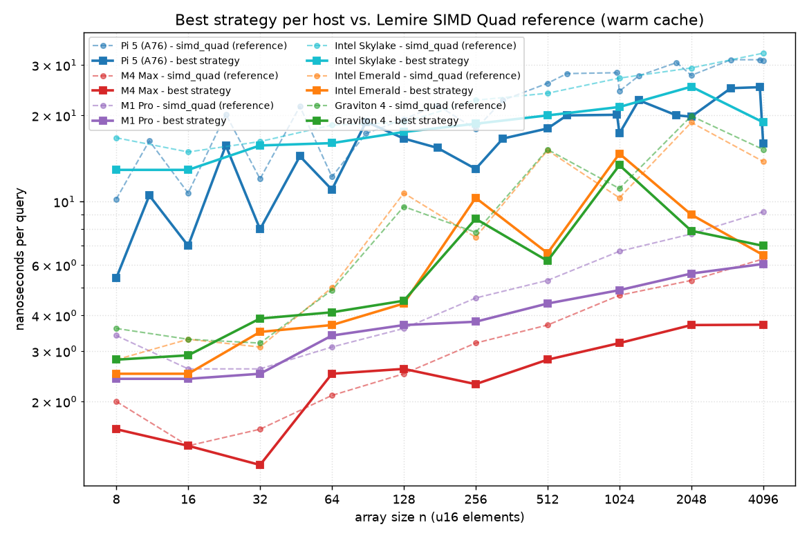
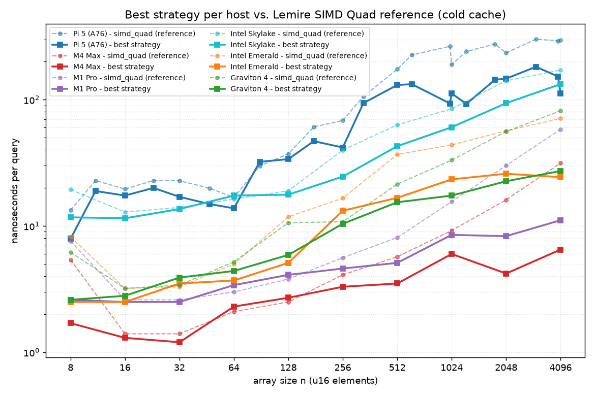

# shar-spine-quad

Machine-optimized variants of Daniel Lemire's "SIMD Quad" search for small
sorted `uint16_t` arrays (n = 1..4096, the shape inside Roaring Bitmap array
containers), plus a two-level benchmark that combines an outer container
search with the tuned inner search for a full 512-container × 4096-element
lookup. Six hosts, four kernel files, one arch-aware benchmark driver.

> **Results corrected 2026-10-11.** A full review found that the kernels are
> correct and the large effects are real, but that several published
> comparisons rested on a mis-aimed prefetch in the Eytzinger variants, on
> medians differenced across drifting runs, on a retired benchmark harness,
> and on plot data without an archived source. Everything below was
> rewritten from paired per-run analysis of the archived runs plus a fresh
> ten-run campaign on the Raspberry Pi 5. The full list of retracted claims
> and their replacements is `Text/corrections_2026-10.md`; when any other
> document disagrees with it, that file wins.

## Hosts and variants

| Host | Core | Cache line | SIMD used | Gap | Block check | In-loop prefetch |
|---|---|---|---|---|---|---|
| Raspberry Pi 5 | Cortex-A76 | 64 B | 128b NEON | 32 | 2× `vld1q_u16_x2` + 4 cmp | in the code, but the archived A/B says it is a net loss (open item) |
| Apple M1 Pro | Firestorm | 128 B | 128b NEON | 64 | 2× `vld1q_u16_x4` + 8 cmp | no |
| Apple M4 Max | M4 P-core | 128 B | 128b NEON | 64 | same file as M1 Pro | no |
| Intel Skylake-SP (8175M) | Skylake | 64 B | AVX2 (zmm gated off) | 32 | 2× ymm cmpeq + movemask | kept (A/B inconclusive) |
| Intel Emerald Rapids (8559C) | Raptor Cove | 64 B | AVX-512 + VBMI2 | 32 | 1× zmm cmpeq + kortest | no |
| AWS Graviton 4 | Neoverse V2 | 64 B | 128b NEON | 32 | same code as the Pi 5 spine kernels | no |

The kernels: `simd_quad.c` (Lemire's reference), `simd_quad_pi5.c`,
`simd_quad_m4.c` (M1 Pro and M4 Max), `simd_quad_intel.c` (Skylake and
Emerald Rapids), `simd_quad_graviton.c`. Each tuned file has a general-n
"spine" kernel (a contiguous array of block-last keys that turns the
quaternary descent into a short streaming read) and compile-time
specializations for n ∈ {256, 512, 1024, 2048, 4096} where measured.

## What the measurements support

* **The spine is the biggest single win on every host**: roughly 2× on the
  Pi 5 (a true DRAM miss) and 2.6× on the M4 Max (3.3× on the M1 Pro, where
  the main bench's cold column is an L2/SLC hit) at n = 4096. The
  mechanism is a short contiguous read with memory-level parallelism, not a
  hardware stride prefetcher.
* **Compile-time specialization at n = 4096 ("hybrid": straight-line descent
  + branchless 2-probe finish) is a robust warm win.** Versus the retired
  unroll: −55% Emerald Rapids and −29% Skylake (ratios of 5-run medians),
  −31% Pi 5 (paired per-run median), −4% M1 Pro, a tie on M4 Max. Versus the
  general-n spine on Skylake it is −32% warm (5/5) but +40% cold (paired
  median, hybrid faster in only 2 of 5 runs) against a control stable to
  ±0.6%, a cost that is not yet explained.
* **At n = 4096 containers the tuned two-level stack beats Lemire's published
  variant on every host and every mode** (paired per-run deltas, 5 archived
  runs per host; F = Shar outer + compile-time inner, Lem = bsearch outer +
  gap-16 SIMD Quad):

  | host | hot_bat | hot_ser | cold_bat | cold_ser |
  |---|---|---|---|---|
  | Pi 5 | −35% (5/5) | −39% (4/5) | −28% (5/5) | −17% (5/5) |
  | M4 Max | −84% (5/5) | −80% (5/5) | −37% (5/5) | −43% (5/5) |
  | M1 Pro | −68% (5/5) | −61% (5/5) | −28% (5/5) | −21% (5/5) |
  | Skylake-SP | −69% (5/5) | −70% (5/5) | −29% (4/5) | −14% (5/5) |
  | Emerald Rapids | −69% (5/5) | −61% (5/5) | −45% (5/5) | −26% (5/5) |
  | Graviton 4 | −65% (5/5) | −74% (5/5) | −25% (5/5) | −7% (4/5) |

  Ten runs of the repaired harness on the Pi 5 (2026-10-11) give F vs Lem
  −37.5% / −39.4% hot (10/10), −17% cold_bat (7/10, a tie) and −30.5%
  cold_ser (8/10).
* **Which outer search wins depends on the host and the cache state.** Best
  variant per mode by paired per-run rank (A = bsearch + general-n inner,
  B = outer spine + general-n, C = bsearch + compile-time inner, D = outer
  spine + compile-time inner, E = Shar + general-n, F = Shar + compile-time,
  H/I = Eytzinger + prefetch, measured before the prefetch fix except on the
  Pi 5):

  | host | hot_bat | hot_ser | cold_bat | cold_ser |
  |---|---|---|---|---|
  | Pi 5 (repaired harness, 10 runs) | **D** (B, E, F within 3%) | **D** | **D** (F +45%) | noise |
  | M4 Max | F (I ties) | F | E (F ties) | B |
  | M1 Pro | I (F ties) | I (−11% vs F, 4/5) | F | A |
  | Skylake-SP | F | F | C (D beats F 4/5) | D |
  | Emerald Rapids | I (−0.7% vs F, negligible) | F | C | C |
  | Graviton 4 | I (−11% vs F, 5/5) | F | C | C |

  Shar's branchless outer (E, F) wins hot on the five fast hosts because it
  has no branch mispredicts and no side structure; it is a *serial*
  load-compare-select chain, not a set of independent loads. Cold, the
  branchy `std::lower_bound` (C) or the outer spine (D) usually wins because
  the core can speculate ahead across a branchy search but not past a cmov
  chain. On the Pi 5 the outer spine (D) is best or tied-best in three modes.
* **Lemire's kernel is still faster for small containers.** The only sweep
  across container sizes (M4 Max, 200 sizes, 5 runs) has Lemire ahead in
  all 5 runs at every size in the bands n = 48–62 and 81–124 (hot, medians
  5–33%) and n ≤ 7 and 64–95 (cold_ser, 19–47%): the gap-64 kernel's small-n paths end in long
  scalar sweeps and the spine is inert below n = 256 on 128-byte-line hosts.
* **The Eytzinger + prefetch outer (Khuong & Morin 2017) does not pay off on
  the Pi 5** once the prefetch is aimed correctly: I is 7–9% slower than F
  hot and never beats D. Its M1 Pro hot_ser edge (−11%, 4/5) and Graviton 4
  hot_bat edge (−11%, 5/5) were measured with the mis-aimed prefetch and
  need re-measurement.

### Single-lookup latency at n = 4096 (ns per query, medians of 5 runs)

| host | general-n spine kernel, warm / cold | compile-time n=4096 hybrid, warm / cold |
|---|---|---|
| M4 Max | 4.3 / 6.5 | 3.7 / 21.9 |
| M1 Pro | 6.3 / 11.1 | 6.1 / 32.1 |
| Emerald Rapids | 18.0 / 37.2 | 6.5 / 24.4 |
| Graviton 4 | 16.2 / 34.6 | 7.0 / 27.2 |
| Pi 5 | 22.5 / 150.7 | 16.0 / 111.9 |
| Skylake-SP | 26.8 / 132.7 | 18.9 / 185.0 |

Sources: `{host}_runs/rebench_run*.txt` for the spine column; the hybrid
column from `{host}_runs/hybrid_run*.txt` (M4 Max, M1 Pro, Skylake),
`emr_runs/shipped_run*.txt`, `gv4_runs/fullsweep_run*.txt` and the Pi 5
rebench rows, as recorded in `plot.py`. Two caveats: the main bench's "cold"
column has no cache flush, so it is a DRAM miss on the Pi 5 but an L2/L3 hit
on the other hosts (compare within a host, not across hosts); and the Apple
hybrid cold numbers may be a measurement-order artifact rather than a
kernel property (see the corrections document, section 5).





Curves show 22 sizes for the Pi 5 and the 10 power-of-two sizes for the
other hosts; only values with an archived raw run are plotted.

## Quick start

```sh
./reproduce.sh            # detects host, builds, runs bench + bench_twolevel, compares to archived medians
./reproduce.sh --runs 5   # per-cell median of 5 runs
./reproduce.sh --quick    # lighter 2000×2000 intensity

# Two-level campaign with randomised variant order, then paired analysis
./run_twolevel.sh pi5 10
python3 compute_twolevel_paired.py pi5 --glob 'pi5_runs/twolevel_v2_run*.txt' --out pi5_runs/twolevel_paired_v2.txt
```

The paired aggregator reports per-run sign counts and paired medians. Quote
those, never the difference of two per-variant medians: whole runs drift
1.5× on the Pi 5 and up to 1.5× on the M4 Max, and ratios of medians taken
from different runs produced several of the retracted claims.

## Manual build

```sh
# Raspberry Pi 5
g++ -O3 -mcpu=cortex-a76 -std=c++20 bench.cpp simd_quad_pi5.c simd_quad_m4.c simd_quad_graviton.c -o bench
g++ -O3 -mcpu=cortex-a76 -std=c++20 -DQUADSEARCH_ARM_PI5 bench_twolevel.cpp simd_quad_pi5.c -o bench_twolevel

# Apple M4 Max / M1 Pro (-mcpu=apple-m1 for the M1)
clang++ -O3 -mcpu=apple-m4 -std=c++20 bench.cpp simd_quad_pi5.c simd_quad_m4.c simd_quad_graviton.c -o bench
clang++ -O3 -mcpu=apple-m4 -std=c++20 bench_twolevel.cpp simd_quad_m4.c -o bench_twolevel

# AWS Graviton 4
g++ -O3 -mcpu=neoverse-v2 -std=c++20 bench.cpp simd_quad_pi5.c simd_quad_m4.c simd_quad_graviton.c -o bench
g++ -O3 -mcpu=neoverse-v2 -std=c++20 -DQUADSEARCH_ARM_GV4 bench_twolevel.cpp simd_quad_graviton.c -o bench_twolevel

# Intel with AVX-512 + VBMI2 (Ice Lake-SP, Sapphire / Emerald / Granite Rapids).
# Note: -march=x86-64-v4 does NOT define __AVX512VBMI2__ and silently builds the AVX2 path.
g++ -O3 -march=sapphirerapids -std=c++20 bench.cpp simd_quad_intel.c -o bench

# Intel Skylake-SP (AVX-512BW but no VBMI2; the zmm block check is gated off on purpose)
g++ -O3 -march=native -std=c++20 bench.cpp simd_quad_intel.c -o bench
```

`./bench 4000 5000` is the canonical intensity; it prints `correctness: ok`
before the table. `./bench_twolevel [sets] [reps] [hb|hs|cb|cs|all] [order_seed]`.

## Files

- `simd_quad.c` — Lemire's reference kernel (NEON / SSE2), `#include`d as a bare body.
- `simd_quad_pi5.c`, `simd_quad_m4.c`, `simd_quad_intel.c`, `simd_quad_graviton.c` — tuned kernels, spines, compile-time families. The Graviton spine kernels are byte-identical to the Pi 5 ones.
- `bench.cpp` — correctness check + per-size warm/"cold" table for every kernel linked on the host.
- `bench_twolevel.cpp` — 512 containers × 4096 inner, variants A–I + Lem, four modes (hot/cold × batched/serial), randomised timing order, warm-up pass, 512 MB cache flush before each cold cell.
- `run_twolevel.sh`, `compute_twolevel_paired.py` — run campaigns and aggregate them with paired per-run statistics.
- `plot.py` — datasets (only archive-derivable values) + figure generator; writes the PNGs and `bench_table.txt`.
- `reproduce.sh` — host-aware build + run + comparison against archived medians.
- `{pi5,m4,m1,skx,emr,gv4}_runs/` — raw archived runs, per-host aggregators, `twolevel_paired.txt` (and `twolevel_paired_v2.txt` on the Pi 5).
- `Text/corrections_2026-10.md` — the corrections record. `Text/` also holds the blog draft, talk, glossary and design notes; `KhuongMorin.md` documents the Eytzinger experiment and its retraction.

## Known limitations and open items

- Variants H and I were measured with a mis-aimed prefetch on five of six hosts; only the Pi 5 has been re-run. The two-level dicts in `plot.py` and the bar chart label them "pre-fix".
- The main bench's "cold" column is not a cache flush; the two-level harness's "hot" modes are hot only for the 1 KB outer array.
- "One block = one cache line" requires a line-aligned array. The harnesses use `std::vector` (16-byte alignment), so most blocks straddle two lines; a Roaring integration should align container arrays and spines.
- The Pi 5 kernel's in-loop prefetch is a net loss by the project's own data and should be removed after a dedicated A/B.
- Repository hygiene (tracked binaries, third-party PDFs and scans, thousands of one-line sweep files) is listed in the corrections document and has not been addressed.

## Background

Starts from Daniel Lemire's post [*You can beat the binary
search*](https://lemire.me/blog/2026/04/27/you-can-beat-the-binary-search/)
and its SIMD Quad algorithm. The branchless outer search is Leonard Shar's
1971 step-halving binary search (`bit_floor(len)` plus a `len − step`
offset for non-power-of-two lengths). The Eytzinger + prefetch outer follows
Khuong & Morin, "Array Layouts for Comparison-Based Searching" (2017),
adapted to a 1-based layout.

## License

The code is MIT-licensed (see `LICENSE`). `Text/article.text` is a copy of
Daniel Lemire's blog post, © Daniel Lemire, kept for reference only and not
covered by the MIT licence; read `simd_quad.c` for the reference kernel.
